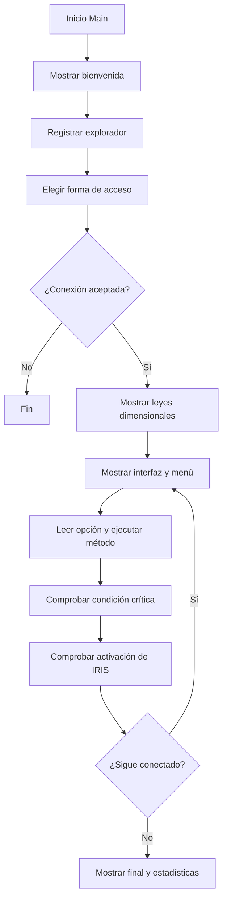

# Guía técnica y de estudio — NEXUS 0.2

**Proyecto:** NEXUS 0.2 — Dimensión Espejo 267  
**Lenguaje:** C#  
**Aplicación:** consola  
**Archivo fuente revisado:** Mision 2.cs

---

## 1. Alcance

Esta guía describe la versión almacenada en Mision 2.cs. Su organización toma como referencia la documentación de POO-Nexus, pero el contenido se adapta a la implementación real.

Se distingue entre lo implementado, los conceptos de estudio y las mejoras propuestas. No se atribuyen a esta versión clases de personajes, herencia, polimorfismo, interfaces ni colecciones de objetos que no aparecen en el archivo.

## 2. Resumen funcional

El programa inicia una sesión de exploración en la Dimensión Espejo 267. El jugador registra nombre y edad, recibe un perfil aleatorio y accede mediante el código 267 o por transferencia accidental.

Durante la sesión administra energía, estabilidad, peligro e información. Puede explorar, investigar, consultar su estado, recuperar energía, intentar desconectarse, ocultarse, reparar el equipo y comunicarse con NEXUS.

La investigación puede revelar tres documentos. Los documentos y la comunicación permiten descubrir que NEXUS fue responsable de un procedimiento fallido para destruir la dimensión. Bajo condiciones especiales también puede intervenir IRIS.

## 3. Estructura real del código

El archivo contiene una clase principal llamada Program. Dentro de ella se encuentran Main(), los campos estáticos, el arreglo de documentos y los métodos de la aplicación.

### 3.1 Datos de estado

| Variable | Tipo | Uso |
|---|---|---|
| random | Random | Genera elecciones y resultados aleatorios. |
| explorerName | string | Nombre del explorador. |
| explorerProfile | string | Perfil asignado. |
| age | int | Edad introducida. |
| energy | int | Energía actual. |
| stability | int | Estabilidad actual. |
| danger | int | Nivel de peligro. |
| information | int | Información acumulada. |
| permanentDamage | int | Daño que reduce el máximo de energía y estabilidad. |
| connected | bool | Determina si la sesión continúa. |
| irisActivated | bool | Evita activar IRIS más de una vez. |
| irisEnding | bool | Indica si ocurrió el final oculto. |
| truthDiscovered | bool | Indica si se descubrió la verdad sobre NEXUS. |
| criticalWarningShown | bool | Controla la repetición de la advertencia crítica. |
| documentsFound | int | Cuenta los documentos recuperados. |
| operationsPerformed | int | Cuenta operaciones registradas por el programa. |

Los campos están declarados como static: pertenecen a la clase y se comparten durante la ejecución, en lugar de pertenecer a una instancia de Program.

### 3.2 Arreglo de documentos

documents es un arreglo de cadenas (string[]) con tres registros:
1. Documento 01: anomalía dimensional y alteraciones de las leyes físicas.
2. Documento 02: una operación desconocida y una señal identificada como NEXUS.
3. Documento 03: NEXUS inició un procedimiento para destruir la dimensión y fracasó.

FindDocument() muestra el siguiente elemento disponible usando documentsFound como índice y luego incrementa el contador.

## 4. Métodos y responsabilidades

| Método | Responsabilidad |
|---|---|
| Main() | Organiza la secuencia general y el ciclo de juego. |
| ShowWelcome() | Presenta la pantalla inicial. |
| RegisterExplorer() | Solicita nombre y edad, asigna perfil y comprueba edad mínima. |
| EnterDimension() | Gestiona el acceso por código o accidente. |
| ShowDimensionLaws() | Explica las cuatro leyes de la dimensión. |
| ShowInterface() | Presenta datos del explorador e indicadores. |
| ShowBar() | Dibuja una barra de porcentaje en consola. |
| ShowMenu() | Imprime las ocho operaciones. |
| Explore() | Consume recursos, aplica una ley y modifica indicadores. |
| Investigate() | Selecciona un resultado de investigación. |
| FindDocument() | Recupera un documento si quedan disponibles. |
| ApplyDimensionLaw() | Aplica un efecto aleatorio de gravedad, tiempo, materia o percepción. |
| ConsultStatus() | Informa los valores y clasifica el estado. |
| RecoverEnergy() | Recupera energía y reduce estabilidad. |
| AttemptDisconnection() | Comprueba si se descubrió la verdad y permite finalizar la conexión. |
| Hide() | Consume energía y reduce peligro. |
| RepairSystem() | Consume energía y recupera estabilidad. |
| CommunicateWithNexus() | Cambia el diálogo según los documentos encontrados. |
| CheckCriticalCondition() | Detecta indicadores críticos y muestra advertencias. |
| CheckIris() | Comprueba las condiciones para activar IRIS. |
| ActivateIris() | Ejecuta el evento de IRIS y puede activar el final oculto. |
| ApplyPermanentDamage() | Aumenta el daño permanente hasta el límite establecido. |
| GetMaximumValue() | Calcula el máximo actual: 100 menos daño permanente. |
| NormalizeValues() | Ajusta indicadores a sus límites y termina si energía o estabilidad llegan a cero. |
| ReadNumber() | Repite la lectura hasta recibir un entero dentro del rango. |
| ShowFinalMessage() | Muestra el desenlace y las estadísticas. |
| Pause() | Espera que el usuario presione ENTER. |

## 5. Flujo principal de ejecución

Main() coordina el programa:
1. Establece el título de la consola.
2. Llama a ShowWelcome().
3. Registra al explorador con RegisterExplorer().
4. Gestiona la entrada con EnterDimension().
5. Si la conexión fue rechazada, termina la ejecución inicial.
6. Muestra las leyes dimensionales.
7. Mientras connected sea verdadero, muestra interfaz y menú, lee una opción y ejecuta el método correspondiente.
8. Si la conexión continúa, comprueba condiciones críticas y la posible activación de IRIS.
9. Pausa antes de la siguiente operación.
10. Al salir del ciclo, llama a ShowFinalMessage().

### Diagrama simplificado

## 6. Decisiones y ciclos

### Condicionales
El código utiliza if, else if y else para elegir comportamientos. Por ejemplo, ConsultStatus() clasifica al explorador como crítico si energía es como máximo 20, estabilidad como máximo 25 o peligro como mínimo 80. Si no, comprueba el nivel de precaución; de lo contrario informa que está estable.

### Selección múltiple con switch
El menú principal utiliza switch (option) para relacionar cada número con una operación. ApplyDimensionLaw() también utiliza switch para aplicar uno de cuatro efectos posibles.

### Ciclo while
while (connected) mantiene activa la sesión hasta que alguna operación cambie connected a false.

### Ciclo do-while
ReadNumber() utiliza do-while para solicitar nuevamente el dato si no es un entero válido o si está fuera del rango permitido.

## 7. Aleatoriedad

El programa crea un generador mediante new Random(). Se utiliza para:
- Asignar uno de los tres perfiles del explorador.
- Seleccionar uno de los tres resultados de investigación.
- Seleccionar una de las cuatro leyes dimensionales durante la exploración.

Por ello, dos ejecuciones pueden producir secuencias distintas. Una mejora para las pruebas sería permitir una semilla fija.

## 8. Reglas de indicadores

### Energía y estabilidad
GetMaximumValue() devuelve 100 - permanentDamage. Si el daño permanente es 20, el máximo de energía y estabilidad es 80.

### Normalización
NormalizeValues():
- Limita energía y estabilidad al máximo dinámico.
- Evita que energía y estabilidad sean negativas.
- Mantiene peligro e información entre 0 y 100.
- Cambia connected a false si energía o estabilidad llegan a cero.

### Daño permanente
ApplyPermanentDamage(10) se invoca cuando la investigación produce una consecuencia. El daño acumulado no puede superar 40. Al aumentar, reduce el máximo disponible de energía y estabilidad.

### Exploración
Explore() consume 10 de energía y 3 de estabilidad, incrementa operationsPerformed, aplica una ley dimensional aleatoria y evalúa peligro y estabilidad para modificar peligro o información.

### Investigación
Investigate() consume 8 de energía e incrementa el contador de operaciones. Hay tres resultados:
- Recompensa: información +15.
- Descubrimiento: intenta recuperar un documento e información +10.
- Consecuencia: peligro +12, estabilidad −8 y daño permanente +10.

Los valores se normalizan al final.

## 9. Documentos, verdad y comunicación

La historia se revela en etapas. Encontrar los tres documentos no cambia por sí solo truthDiscovered: el jugador también debe comunicarse con NEXUS cuando ya tiene los tres. En ese diálogo NEXUS confirma que el procedimiento de destrucción existió y reconoce que fue responsable. Entonces el código establece truthDiscovered = true.

AttemptDisconnection() comprueba esa variable. Si todavía es falsa, rechaza el intento y aumenta el peligro. Si es verdadera y energía y estabilidad son mayores que cero, inicia la desconexión segura y termina la conexión.

## 10. IRIS y finales

### Condiciones de activación
CheckIris() activa IRIS si todavía no se ha activado y se cumplen simultáneamente:
- Peligro >= 85.
- Estabilidad <= 25.
- Información >= 60.

### Efectos del primer contacto
ActivateIris() marca el evento como activado y modifica los indicadores:
- Energía −15.
- Estabilidad −15.
- Peligro +15.

Después normaliza los valores. Si peligro >= 95, estabilidad <= 10 y energía <= 15, activa irisEnding y desconecta la sesión.

### Desenlaces
| Final | Condición general |
|---|---|
| Final oculto: IRIS | Se activa IRIS y se cumplen las condiciones extremas posteriores al evento. |
| Final: VERDAD | Se descubrió la verdad y la sesión termina después de una desconexión segura. |
| Final: CONEXIÓN PERDIDA | La sesión termina sin que se cumpla una de las dos condiciones anteriores. |

## 11. Conceptos de C# presentes

| Concepto | Uso en NEXUS |
|---|---|
| Clase | La clase contenedora Program. |
| Métodos | Operaciones separadas como Explore(), Investigate() y RepairSystem(). |
| Campos estáticos | Variables que mantienen el estado de la sesión. |
| Tipos de datos | int, bool y string. |
| Arreglos | string[] profiles y string[] documents. |
| Condicionales | Decisiones sobre acceso, estado, eventos y finales. |
| Ciclos | while, for y do-while. |
| switch | Procesamiento del menú y de las leyes dimensionales. |
| Aleatoriedad | Instancia de Random. |
| Validación | int.TryParse() y comprobaciones de rango. |
| Consola | Lectura, escritura, colores y pausa. |

## 12. Temas de POO: qué está y qué no está implementado

### Está presente
- Existe una clase llamada Program.
- El código está dividido en métodos con responsabilidades concretas.
- Los métodos y campos son estáticos.
- Se utilizan tipos de datos, arreglos y objetos de biblioteca como Random.

### No está implementado en esta versión
- No existe una clase abstracta Personaje.
- No hay clases derivadas como Cadete, Enemigo o Robot.
- No se usa herencia ni sobrescritura con virtual y override.
- No hay interfaces propias.
- No existe un inventario de objetos del explorador.
- No se observan consultas LINQ ni expresiones lambda.

### Evolución posible
Una futura versión podría encapsular los indicadores en EstadoExplorador, el registro en Explorador, las reglas dimensionales en Dimension y la coordinación en SesionNexus. Son propuestas de diseño, no componentes actuales.

## 13. Preguntas de estudio

1. **¿Qué función cumple Main()?** Es el punto de entrada y coordina bienvenida, registro, acceso, ciclo de operaciones y cierre.
2. **¿Por qué connected es bool?** Porque representa dos estados: la sesión continúa o terminó.
3. **¿Qué diferencia hay entre energy y GetMaximumValue()?** energy es el valor actual; GetMaximumValue() calcula el máximo según el daño permanente.
4. **¿Para qué sirve NormalizeValues()?** Mantiene los indicadores dentro de sus límites y termina la sesión si energía o estabilidad llegan a cero.
5. **¿Por qué se utiliza Random?** Para variar perfiles, resultados de investigación y leyes dimensionales.
6. **¿Qué diferencia hay entre while y do-while?** while comprueba la condición antes de repetir; do-while ejecuta al menos una vez.
7. **¿Cuándo se descubre la verdad sobre NEXUS?** Después de recuperar los tres documentos y comunicarse con NEXUS.
8. **¿Por qué no se puede desconectar inmediatamente?** AttemptDisconnection() exige truthDiscovered y energía y estabilidad mayores que cero.
9. **¿Cómo se activa IRIS?** Peligro >= 85, estabilidad <= 25 e información >= 60, si no se había activado.
10. **¿Este código demuestra herencia y polimorfismo?** No. No declara una jerarquía de clases ni métodos virtuales sobrescritos.

## 14. Observaciones y mejoras posibles

1. Separar el estado, el explorador, la dimensión y la sesión en clases cuando el proyecto evolucione.
2. Comprobar que Console.ReadLine() no devuelva null antes de usar el texto.
3. Permitir configurar una semilla para el generador aleatorio durante las pruebas.
4. Probar secuencias distintas para revisar el equilibrio de los indicadores y la posibilidad de alcanzar los finales.
5. Separar la interfaz de consola de las reglas del juego.
6. Probar condiciones límite: energía cero, estabilidad cero, daño permanente máximo, tres documentos y condiciones de IRIS.

Estas son propuestas de mejora; no significan que el programa ya tenga esas funciones.

## 15. Lista de comprobación

- [ ] Compila con .NET 10.
- [ ] El archivo principal conserva el nombre Mision 2.cs.
- [ ] Funcionan el acceso por código 267 y la transferencia accidental.
- [ ] Responden las ocho operaciones del menú.
- [ ] Los indicadores permanecen dentro de sus límites.
- [ ] Se pueden recuperar los tres documentos.
- [ ] La comunicación con NEXUS permite descubrir la verdad.
- [ ] Se verifican los finales y las condiciones de IRIS.
- [ ] La documentación coincide con el código publicado.

---
**Nota:** esta guía documenta NEXUS 0.2. Debe actualizarse cuando cambien las variables, los métodos, las reglas o los finales.
